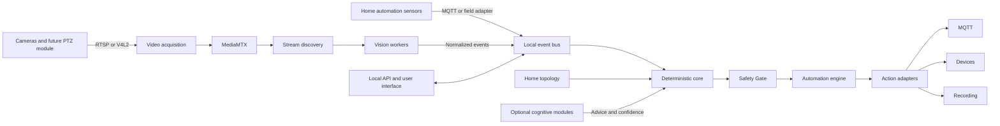

# Synora Hardware Architecture and Prototyping Choices

## Purpose

Synora is designed as an edge home automation system capable of receiving data streams from cameras and sensors, correlating them with the home's topology, and then proposing or triggering controlled actions. The prototype prioritizes local processing, hardware modularity, and service continuity over dependence on a specific board, camera, or accelerator.

The key architectural decision is that the hardware can evolve without changing the functional core. The compute board, cameras, AI models, and field buses are connected through explicit, versioned, and replaceable adapters. The deterministic core and the Safety Gate remain the final authorities.

This document describes the current prototyping choices. It is neither a production bill of materials nor an industrial qualification report.

## Decision Status

| Status | Meaning |
|---|---|
| **Selected** | Architectural choice to preserve during prototyping |
| **Validated on prototype** | Successfully executed on the stated development hardware |
| **Partially validated** | Part of the path works, but the complete chain is not qualified |
| **Planned** | Contract or architectural extension point defined; hardware integration remains |
| **To be measured** | Mechanical, electrical, or thermal assumption to confirm on a physical sample |

## Hardware Architecture Principles

### Local-first processing

Data streams and events are processed as close to the home as possible. The prototype must continue to provide its essential functions over the local network, even without access to a cloud service.

This choice provides:

- lower latency for automations;
- greater control over sensitive data;
- a possible degraded operating mode without Internet access;
- a simpler integration surface for local sensors and actuators.

Cloud services may complement Synora for remote administration, notifications, or backup, but they must not become dependencies of the critical local path.

### Hardware-independent core

The Synora core operates on functional contracts: events, states, decisions, topology, and actions. It must not directly depend on a camera driver, model format, or board model.

Hardware dependencies are pushed to the system boundaries:

- video acquisition: RTSP, V4L2, simulation, or replay adapters;
- inference: ONNX engines, platform-specific accelerators, or test implementations;
- actuation: MQTT, device commands, video recording, or future field buses;
- platform: Linux services and hardware profiles describing the capabilities that are actually available.

An adapter can only be activated when it is explicitly allowlisted and compatible with the hardware profile. No silent fallback to another engine may hide an incompatibility.

### Deterministic decisions and Safety Gate

AI models are advisory components. They may enrich event correlation, but they are not the final authority for physical actions.

The target decision path remains:

1. acquire and normalize observations;
2. correlate them with time and the home's topology;
3. generate a proposal from the deterministic engine and, when available, decision-support models;
4. check it through the Safety Gate;
5. emit an action through an authorized adapter.

Unavailable data or branches are declared through explicit availability masks. They are never replaced with zero values that could be mistaken for real observations.

## Prototype Architecture

### Edge compute node

The **Radxa Cubie A7Z** is the hardware prototyping platform currently in use. Its role is to host Linux, Synora services, the local network, and the graphics or video components needed for testing.

This choice is a development platform, not a commitment to the future production platform. The profile-and-adapter abstraction must make it possible to use another board if thermal, video, AI, industrial, or supply-chain requirements demand it.

Current status:

- an official board-specific image is preferred to retain the appropriate bootloader, kernel, device tree, and drivers;
- PowerVR graphics acceleration and OpenGL ES rendering have been observed on the target;
- the Wayland/wlroots rendering bridge has been validated in headless mode;
- prototype storage currently uses a microSD card;
- no storage endurance, thermal, or long-duration qualification is claimed yet.

For an industrialized version, system storage must be reassessed: eMMC or equivalent storage, read-only partitions where possible, bounded logging, and an explicit power-loss recovery strategy.

### Cameras and video

The selected video path relies on standardized streams rather than a direct dependency on a specific camera:

- **RTSP** as the primary interface for network cameras;
- **MediaMTX** as the local stream distribution point;
- discovery of available video paths;
- one isolated vision worker per camera or stream;
- **V4L2** planned for a local camera directly connected to the board;
- simulation and replay adapters retained for reproducible testing.

The software prototype can discover a ready MediaMTX path and start its associated worker. Qualification with a real physical camera remains separate from simulated or replay-based testing.

Raw images must not circulate through the business core, event store, or general-purpose API. Workers produce normalized events limited to the functional need.

### Network and access continuity

The prototype network is designed to prevent a Wi-Fi change from making the board inaccessible:

- a local fallback access point profile;
- a time-bounded switch to a known Wi-Fi network;
- automatic restoration of the access point if the switch fails;
- essential services available over the local network;
- optional remote administration outside the critical path.

Wi-Fi switching with automatic restoration of the fallback access point has been validated on the Cubie A7Z. Wi-Fi secrets are not part of the published configuration.

### Local display

A display is not required for autonomous Synora operation, but it remains useful for development and for a future local interface.

Two outputs have been considered on the prototype:

- micro-HDMI as the direct option;
- DisplayPort Alt Mode over the USB-C 3.1 port.

Headless rendering has been validated on the target. The USB-C DisplayPort link, however, is not qualified: testing showed incomplete link negotiation and reboots probably related to the power topology used. The next validation must power the board and display separately, then connect only the video cable.

### Home automation sensors and actuators

The prototype defines a device registry and associates each device with a room and a role. Events are correlated with an explicit topology of the home, preventing the system from being reduced to a simple list of independent sensors.

The planned action interfaces are:

- MQTT publishing;
- device commands;
- video recording triggers;
- future adapters for the selected field protocols.

In the reviewed prototype code, these action handlers exist as extension points, but physical device commands, MQTT publishing, and actual recording are still marked as integration work. They must not be presented as operational hardware features.

### Mechanical PTZ module

The PTZ camera module is intended to sit beneath a transparent acrylic dome. The current reference envelope is:

| Dimension | Reference value |
|---|---:|
| Outer lip diameter | 84 mm |
| Intermediate diameter | 79.5 mm |
| Advertised usable opening | 76 mm |
| Total height | 45 mm |
| Advertised lip thickness | 2 mm |

These values are used to size the retaining ring and reserve clearance for the PTZ mechanism. They come from a commercial reference and must be measured on a physical sample before any part, mold, or tooling is frozen.

The mechanical prototype must also verify:

- camera travel on both axes;
- collisions between the lens, ribbon cable, motors, and dome;
- infrared reflections and image quality through the acrylic;
- heat buildup inside the enclosed volume;
- movement noise and repeatability;
- accessibility for assembly and maintenance.

## Software Deployment on the Target

The prototype is split into separate Linux services: local bus, core, API, video discovery, vision, actions, runtime management, Web interface, and MediaMTX. This separation isolates responsibilities and allows a component to be restarted or replaced without rebuilding a monolithic process.

Application services run under a dedicated unprivileged account wherever possible, with systemd protections such as `NoNewPrivileges`, `PrivateTmp`, `ProtectSystem`, and `ProtectHome`.

The runtime manager currently designed with elevated privileges must retain a minimal and auditable scope. A production version must remove all unnecessary privileges and explicitly restrict which commands, files, and services it can manage.

## AI Model Choices

Synora separates the model format, its execution engine, and the hardware platform:

- model packages declare their version, provenance, hashes, and input/output contracts;
- engines such as ONNX CPU or a platform-specific accelerator are adapters;
- recognizing a format is not proof that the model can actually run on the board;
- the presence of a library is not proof of access to an NPU;
- compatibility must be confirmed through target execution and parity fixtures.

The proposed cognitive architecture contains three independent roles:

- correlation of simultaneous events;
- correlation of temporal and topological context;
- arbitration of proposals using confidence levels and safety constraints.

These models are not connected to the active decision path of the prototype described here. The deterministic core remains the reference.

## Validation Status

| Element | Status | Evidence or limitation |
|---|---|---|
| Cubie A7Z as prototyping target | Selected | Boot and development work performed on the board |
| Board-specific system image | Partially validated | Image integrity verified; initial write result not qualified end to end |
| Headless Wayland/wlroots rendering | Validated on prototype | Surface rendered and graphics tests executed on the target |
| Wi-Fi switching with fallback access point | Validated on prototype | External connection followed by automatic access point restoration observed |
| RTSP and MediaMTX | Selected | Architecture and services present in the prototype |
| Real physical camera | To be qualified | Simulation or software discovery does not replace a real test |
| DisplayPort over USB-C | Partially validated | Port identified, but video negotiation and power topology are not qualified |
| Physical actions and MQTT | Planned | Extension points present; actual integration remains |
| Model execution on an accelerator | To be qualified | Contracts prepared; no NPU qualification inferred |
| PTZ dome | To be measured | Provisional commercial envelope; physical sample required |
| Thermal, EMC, and endurance | To be qualified | Outside the scope of the current prototype |

## Next Hardware Validation Steps

The recommended order reduces the risk of confusing power, link, and software failures:

1. establish a stable power topology and measure consumption at idle, during video processing, and during PTZ movement;
2. qualify boot and power-loss recovery with the selected storage;
3. validate one real RTSP camera, followed by one local V4L2 camera;
4. measure end-to-end latency from observation to decision and action;
5. integrate one real actuator behind an adapter, with a safe stop and state feedback;
6. qualify the selected inference engine on the target, including temperature, throughput, and result parity;
7. measure the dome and verify optical, mechanical, and thermal behavior with the complete PTZ module;
8. perform an endurance test before selecting a production board or enclosure.

## Decisions That Must Not Be Frozen Too Early

The following items remain deliberately open until prototype measurements can distinguish between the options:

- production compute board;
- AI accelerator and optimized model format;
- final storage type;
- radio protocol or field bus for each device family;
- PTZ motors and position sensors;
- dome material and optical treatment;
- thermal design and enclosure ingress protection rating.

This flexibility is intentional: Synora must be able to evolve from a functional prototype into a robust product without rewriting its core or weakening its safety rules.
