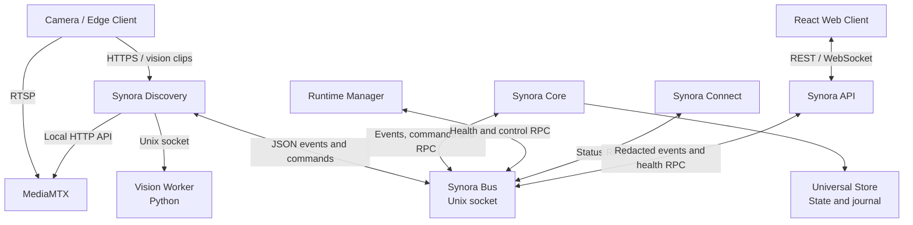

# SYNORA

### Distributed Smart Home & Edge Intelligence Platform

**Go · Python · Linux · Distributed Systems · Computer Vision · IoT**

**Status:** Active Development | **Architecture:** Local-first, Service-oriented | **Platform:** Linux

SYNORA is a modular, local-first platform combining distributed software services, intelligent event processing, computer vision and device integration.

Its architecture is designed to address a central engineering challenge: **building an extensible, reliable system while balancing performance, implementation complexity, operational costs and maintainability.**

The project is developed as an independent software engineering initiative, with an emphasis on system architecture, explicit communication contracts, controlled information flows and reproducible validation.

**[Architecture](docs/ARCHITECTURE.md) · [Getting Started](docs/GETTING_STARTED.md) · [Validation Report](docs/VALIDATION_REPORT.md)**

---

## Overview

SYNORA explores a different approach to smart-home and intelligent monitoring systems.

Rather than combining every capability into one application, the platform separates responsibilities across independent services.

The architecture is built around four principles:

- **Modularity** — Components have clearly defined responsibilities and communication interfaces.
- **Local processing** — Core functionality does not depend on a mandatory cloud control plane.
- **Reliability** — Controlled state mutations, explicit error handling, timeouts and bounded workloads.
- **Engineering efficiency** — Architectural complexity must provide benefits that justify its implementation and operational costs.

The goal is to build a reusable foundation for distributed automation and contextual intelligence.

## System Architecture

SYNORA consists of several specialized services communicating through a local Unix-domain event bus.



*The diagram shows implemented communication paths. The separate API is not integrated into the default service startup, MediaMTX requires an external binary, and the complete central pipeline is not currently qualified.*

### Core Components

| Component | Responsibility | Technology |
|---|---|---|
| **Synora Bus** | Internal event routing, authentication, ACLs and RPC | Go |
| **Synora Core** | State management, decisions and cognitive processing | Go |
| **Universal Store** | Persistent state, journaling and idempotent operations | Go |
| **Discovery** | Device integration, network interfaces and media ingestion | Go |
| **Vision Worker** | Computer vision and aggregate evidence processing | Python |
| **Synora API** | REST endpoints, sessions and WebSocket communication | Go |
| **Web Client** | Application interface | React |
| **Runtime Manager** | Runtime health and service management | Go |

Detailed service boundaries and information flows are documented in [ARCHITECTURE.md](docs/ARCHITECTURE.md).

---

## Engineering Decisions

SYNORA is built around explicit architectural trade-offs.

| Decision | Benefit | Trade-off |
|---|---|---|
| **Custom Unix IPC bus** | Lightweight local communication and controlled service identities | Custom routing logic and non-durable transport |
| **Go / Python separation** | Specialized workloads can evolve independently | Additional IPC and deployment complexity |
| **Centralized state ownership** | Consistent state transitions and auditable persistence | Single local authority without replicated failover |
| **Local-first processing** | Reduced mandatory cloud dependency and control over data flows | Hardware and resource constraints |
| **Independent services** | Modularity and workload isolation | Increased integration and supervision requirements |

The objective is not to maximize architectural complexity, but to choose the appropriate solution for each constraint.

## Key Capabilities

### Distributed Communication

- Unix-domain socket communication.
- JSON message contracts.
- Service authentication and access-control rules.
- Request correlation and timeouts.
- Reconnection and bounded message processing.

### State & Data Integrity

- Core-owned Universal Store.
- Atomic persistence.
- Append-only journal.
- Idempotent state processing.
- Recovery mechanisms.

### Computer Vision

- Dedicated Python worker.
- Local media processing interfaces.
- Aggregate vision evidence contracts.
- Bounded processing workloads.
- Synthetic tests for worker behavior and failure conditions.

### Security Controls

- Session and bearer authentication.
- Bus HMAC support.
- Peer credential verification.
- Input validation and request limits.
- Sensitive-data redaction.
- Fail-closed validation.

These controls are implemented at component level; **the overall system has not undergone an independent production security audit**.

---

## Development & Validation

The latest documented audit was performed on **November 22, 2026**, against commit `535431259eac0839cf5edf77beadc434df604c05`.

| Validation | Result |
|---|---|
| Go compilation | Passed |
| Go tests outside central harness | **623 passing test/subtest events**, 5 skipped |
| Python vision tests | **112 / 112 passed** |
| Python syntax compilation | Passed |
| Configuration validation | Passed |
| Full Go test suite | 7 failures in central test package |
| Central integration harness | Blocked by missing cognitive model bundles |
| Hardware / NPU qualification | Not performed |
| Frontend build | Not reproduced in latest audit |

**Current limitation:** the central harness cannot complete from a fresh checkout because required cognitive model bundles are absent. The default run records 31 passing cases and 508 failed cases, largely cascading from that missing dependency.

These results confirm substantial component-level validation, **not full system or production readiness**.

Full details: [VALIDATION_REPORT.md](docs/VALIDATION_REPORT.md).

---

## Quick Start

**Requirements:** Linux, Go 1.24+, Python 3, Bash, GNU Make and Git.

Clone:

```bash
git clone https://github.com/ANLEXISS/Synora.git
cd Synora
```

Compile Go components:

```bash
go build -buildvcs=false ./...
```

Run the Python vision tests:

```bash
PYTHONDONTWRITEBYTECODE=1 \
PYTHONPATH=services/vision-worker \
  python3 -B -m unittest discover \
  -s services/vision-worker/tests -p 'test_*.py'
```

The complete central harness can be invoked with:

```bash
make test-central-v1
```

The central harness currently requires unavailable cognitive model bundles and does not pass from a fresh checkout.

For isolated tests, dependency configuration and deployment precautions, see [GETTING_STARTED.md](docs/GETTING_STARTED.md).

---

## Current Status & Roadmap

SYNORA is an active engineering prototype with functional components and incomplete end-to-end deployment qualification.

### Current Priorities

- [ ] Make cognitive model bundles reproducible for central validation.
- [ ] Restore passing full-suite integration tests.
- [ ] Resolve API deployment and default port conflicts.
- [ ] Expand CI validation and automated reporting.
- [ ] Qualify real camera and RK3588/NPU processing.
- [ ] Validate MediaMTX with live streams.
- [ ] Extend hardware and protocol integration tests.
- [ ] Benchmark resource consumption and recovery behavior.
- [ ] Review privileged services and production security boundaries.

### Longer-Term Research

- Structured representation of devices and events.
- Context-aware automation.
- Graph-based information relationships.
- Specialized local reasoning models.
- Adaptive processing based on resource and reliability constraints.

These are research directions rather than claims of completed capabilities.

---

## Documentation

| Document | Description |
|---|---|
| **[System Architecture](docs/ARCHITECTURE.md)** | Service boundaries, protocols, data flows and architectural decisions |
| **[Getting Started](docs/GETTING_STARTED.md)** | Build requirements, development setup, testing and troubleshooting |
| **[Validation Report](docs/VALIDATION_REPORT.md)** | Test results, component maturity, limitations and next validation steps |

---

## About the Developer

**Alexis Kratz — Software Engineer**

My primary interest is designing software systems around real constraints: understanding the problem, defining clear rules and interfaces, then finding an appropriate balance between reliability, performance, complexity, scalability and cost.

SYNORA is a practical exploration of this approach through distributed computing, backend development, embedded integration and local intelligence.

**GitHub:** https://github.com/ANLEXISS

**Project:** https://github.com/ANLEXISS/Synora

---

*An independent software engineering and research project. Current capabilities and limitations are documented transparently; production readiness is not claimed.*
