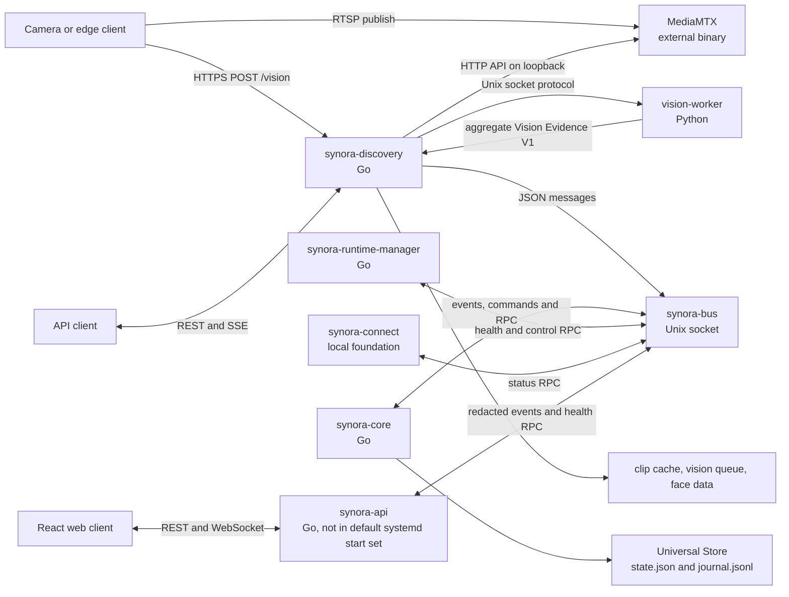

# SYNORA Architecture

## Scope and evidence level

This document describes commit `535431259eac0839cf5edf77beadc434df604c05` on the `master` branch, inspected on 2026-11-22. It describes code and configuration in this repository; it is not a production deployment certification.

Status terms used throughout:

- **IMPLEMENTED**: an executable code path exists.
- **TESTED**: the path was exercised successfully in the current audit.
- **PARTIALLY TESTED**: some layers passed, but the complete path did not.
- **EXPERIMENTAL**: explicitly test-only, dry-run, replay, or candidate code.
- **PLANNED**: described or configured, but no complete implementation was found.
- **UNKNOWN**: the repository does not provide enough evidence.

## System overview

SYNORA is a local, service-oriented Go system with a Python vision worker and a React web client. Go processes exchange newline-delimited JSON messages through a Unix-domain socket. Discovery owns external device-facing HTTP/TLS ingress, local network setup, MediaMTX reconciliation, and the dry-run action boundary. Core owns cognitive state and its durable Universal Store. The Python worker performs optional local clip processing behind a Unix socket. No cloud control plane is implemented in the inspected code.

Only confirmed connections appear in the diagram. In particular, MQTT is omitted: the Go module and a Mosquitto sample configuration exist, but no Go source imports the Paho MQTT package and no MQTT service is installed by the current Makefile. Evidence: [`go.mod`](../go.mod), [`deployments/mosquitto/mosquitto.conf`](../deployments/mosquitto/mosquitto.conf), and [`Makefile`](../Makefile).

## Executables and responsibilities

| Executable | Responsibility | Default deployment status | Evidence |
| --- | --- | --- | --- |
| `synora-bus` | Routes authenticated/allowlisted JSON events, commands, and RPC over `/run/synora/bus.sock`; checks peer UID and executable name. | **IMPLEMENTED**, unit-tested; systemd unit present. | [`cmd/synora-bus/main.go`](../cmd/synora-bus/main.go), [`internal/bus/server.go`](../internal/bus/server.go), [`internal/bus/acl.go`](../internal/bus/acl.go) |
| `synora-core` | Consumes admitted events, computes snapshots/decisions, applies the Safety Gate in dry-run mode, and owns the Universal Store. | **IMPLEMENTED**, component tests pass; model-backed central path currently blocked by absent bundles. | [`cmd/synora-core/main.go`](../cmd/synora-core/main.go), [`internal/cognitivecore/service.go`](../internal/cognitivecore/service.go), [`internal/cognitivecore/store.go`](../internal/cognitivecore/store.go) |
| `synora-discovery` | Owns device ingress, SynoraNet setup, MediaMTX reconciliation, worker supervision, external REST/SSE API, and the dry-run action adapter. | **IMPLEMENTED**, component-tested; hardware deployment not validated in this audit. | [`internal/discovery/bootstrap.go`](../internal/discovery/bootstrap.go), [`internal/discovery/manager.go`](../internal/discovery/manager.go) |
| `synora-runtime-manager` | Answers bounded runtime health/control RPC using systemd, disk, network, and MediaMTX probes. | **IMPLEMENTED**, component-tested; not exercised against an installed runtime. | [`cmd/synora-runtime-manager/main.go`](../cmd/synora-runtime-manager/main.go), [`internal/manager/manager.go`](../internal/manager/manager.go) |
| `synora-connect` | Maintains local identity/state and answers `connectivity.status`; uses a no-op tunnel controller. | **EXPERIMENTAL foundation**; no external network or WireGuard interface is created. | [`cmd/synora-connect/main.go`](../cmd/synora-connect/main.go), [`internal/connectivity/agent.go`](../internal/connectivity/agent.go) |
| `synora-api` | Serves the React application, session-authenticated Intelligence REST endpoints, WebSocket updates, and runtime health. | **IMPLEMENTED but not integrated into the default service set**: built and installed, but no systemd unit/start entry exists. | [`cmd/synora-api/main.go`](../cmd/synora-api/main.go), [`cmd/synora-api/ws.go`](../cmd/synora-api/ws.go), [`Makefile`](../Makefile) |
| Administrative commands | Bootstrap/validate configuration, inspect camera readiness, validate OEM profiles/model packages, rotate tokens, report version, and perform boot checks. | **IMPLEMENTED** with varying test coverage. | [`cmd/`](../cmd), [`Makefile`](../Makefile) |

The default systemd runtime set is Bus, Runtime Manager, Core, Discovery, Connect, and MediaMTX. `synora-api` is absent from both `RUNTIME_SERVICES` and `deployments/systemd/`. Discovery and `synora-api` also default to the same `:8080` and `:8443` listeners. Running both without explicit address overrides would therefore conflict. This is an observed integration gap, not an architectural interpretation.

## Communication boundaries

### Local event bus

The bus uses a Unix-domain stream socket and newline-delimited `contract.Message` JSON frames. A message carries identifiers, type, kind (`event`, `command`, or `rpc`), source, target, timestamp, correlation/revision metadata, optional HMAC fields, and a raw JSON payload. The server enforces a service allowlist, source/target ACLs, replay tracking, maximum frame size, peer credentials, and expected executable names. HMAC authentication is optional but becomes fail-closed when partially configured. Evidence: [`pkg/contract/message.go`](../pkg/contract/message.go), [`internal/bus/client.go`](../internal/bus/client.go), [`internal/bus/server.go`](../internal/bus/server.go), and [`internal/bus/auth.go`](../internal/bus/auth.go).

The client reconnects after disconnection and bounds RPC waits. Its incoming channel is bounded; when full, it logs and drops the new message. The bus itself is not a durable broker. Core persistence and the separate outbox abstraction provide durability at business-state boundaries, not for every bus frame.

### External HTTP surfaces

Discovery exposes:

- `/api/v1/state`, `/history`, `/health`, `/subscribe`, `/commands`, and `/messages`;
- resident face-gallery operations;
- `/vision` on the dedicated vision ingress listener;
- `/healthz` on a separate health listener.

Bearer-token middleware protects non-public Discovery routes. The vision ingress validates device trust and request authentication before accepting bounded clip data. Evidence: [`internal/discovery/web_v1.go`](../internal/discovery/web_v1.go), [`internal/discovery/api_server.go`](../internal/discovery/api_server.go), and [`internal/discovery/ingress/server.go`](../internal/discovery/ingress/server.go).

The separate `synora-api` executable exposes session-authenticated Intelligence endpoints, `/api/system/*`, `/api/ws`, `/health`, and static web assets. Its WebSocket hub observes only redacted Core decision/snapshot events. Evidence: [`cmd/synora-api/main.go`](../cmd/synora-api/main.go), [`cmd/synora-api/auth.go`](../cmd/synora-api/auth.go), and [`cmd/synora-api/ws.go`](../cmd/synora-api/ws.go).

### Vision worker IPC

Discovery supervises and connects to the Python worker through `/run/synora/vision-worker.sock`. The protocol starts with capability negotiation, then sends bounded clip/segment requests and receives aggregate events. The worker has no HTTP debug server. Raw frames, bounding boxes, embeddings, identity, and local paths are rejected from the Core-facing Evidence V1 contract. Evidence: [`internal/discovery/vision/runtime.go`](../internal/discovery/vision/runtime.go), [`services/vision-worker/worker.py`](../services/vision-worker/worker.py), and [`pkg/contract/vision_evidence_v1.go`](../pkg/contract/vision_evidence_v1.go).

### Media and IoT protocols

- **RTSP over TCP — PARTIALLY IMPLEMENTED:** MediaMTX configuration listens on `8554`, and Discovery reconciles explicit camera paths through the loopback MediaMTX HTTP API. The MediaMTX executable is not stored in this checkout, and no live stream was tested.
- **HLS and WebRTC — CONFIGURED, NOT VALIDATED:** MediaMTX configuration enables ports `8888` and `8889`; application-level playback was not exercised.
- **HTTPS device ingress — IMPLEMENTED, COMPONENT-TESTED:** `/vision` accepts authenticated clips; real camera transport was not tested.
- **V4L2 — EXPERIMENTAL/PREFLIGHT ONLY:** represented in OEM profiles and qualification probes, but no live device path was exercised.
- **MQTT — PLANNED/UNUSED:** dependency and sample broker configuration only; no active source integration was found.
- **ONVIF — UNKNOWN/NOT FOUND:** no implementation was found in current source.

## Persistence and data ownership

| Data | Owner and storage | Status |
| --- | --- | --- |
| Cognitive decisions, snapshots, processed IDs, resident-gallery records, action outbox | Core Universal Store under `${SYNORA_STORE_DIR}` or, by default, `/var/lib/synora/state/universal-store`; atomic `state.json`, append-only `journal.jsonl`, and optional immutable segments. | **IMPLEMENTED**, persistence/recovery tests pass. |
| Discovery snapshot/history projection | In-memory bounded cache populated from `core.snapshot`; maximum history 256. | **IMPLEMENTED**, not a second authoritative store. |
| Clips and vision queue | `/var/lib/synora/clips`, including `.vision-queue.json`; bounded admission/retention policies. | **IMPLEMENTED**, component-tested; live retention not validated. |
| Face data/dataset metadata | `/var/lib/synora/vision/face` by default. | **PARTIALLY TESTED** with synthetic/temp data; real biometric qualification absent. |
| Sessions | `/var/lib/synora/auth/sessions.json` by default; server stores session hashes. | **IMPLEMENTED**, component-tested. |
| Connectivity identity/state | `/var/lib/synora/connectivity`. | **IMPLEMENTED local foundation**; remote transport absent. |
| Legacy/general state package | `internal/state` has atomic persistence and tests, but active Core uses `cognitivecore.UniversalStore`. | **IMPLEMENTED library**, not the active Core authority. |

Evidence: [`internal/cognitivecore/store.go`](../internal/cognitivecore/store.go), [`internal/discovery/snapshot_cache.go`](../internal/discovery/snapshot_cache.go), [`internal/security/session_store.go`](../internal/security/session_store.go), and [`internal/connectivity/state.go`](../internal/connectivity/state.go).

## End-to-end flow 1: camera evidence to dry-run result

**Status: PARTIALLY TESTED.** Component layers pass, but the current central harness cannot complete because its V1/V3 model bundles are absent from `build/`.

1. A paired camera/edge client sends an authenticated clip to Discovery's `/vision` endpoint.
2. Discovery validates request size, device trust, timestamps/authentication, clip limits, and model admission. It stores temporary media locally and enqueues a `ClipJob`.
3. The bounded worker pool calls the Python worker over the Unix socket. The worker returns aggregate `synora.vision.evidence/v1` data or a typed unavailable/failure result.
4. Discovery publishes a JSON `contract.Message` to Core over the Unix bus. The ACL permits only the Evidence V1 boundary; legacy/raw vision contracts are rejected.
5. Core validates and processes the event, commits the resulting snapshot/decision to its Universal Store, and then emits `core.decision` and `core.snapshot` to Discovery and the API consumer.
6. If the Safety Gate produces an action request, Core sends `action.request` to Discovery. Current production construction uses `Boundary{DryRun: true}`; it does not call physical hardware.
7. Discovery publishes an action result back to Core, which records it idempotently.

Errors are explicit: failed authentication returns HTTP rejection; worker unavailability produces a typed degraded result; invalid/legacy evidence is rejected before Store mutation; Store persistence errors fail the Core operation; unavailable bus targets are logged. Evidence: [`internal/discovery/ingress/server.go`](../internal/discovery/ingress/server.go), [`internal/discovery/vision/worker_pool.go`](../internal/discovery/vision/worker_pool.go), [`internal/cognitivecore/service.go`](../internal/cognitivecore/service.go), and [`internal/discovery/manager.go`](../internal/discovery/manager.go).

## End-to-end flow 2: authenticated web command to Core

**Status: PARTIALLY TESTED in hermetic component tests; not validated as a deployed multi-process system.**

1. A client posts JSON `{ "command": "...", "arguments": { ... } }` to Discovery `/api/v1/commands` with a valid bearer token.
2. The Discovery `Boundary` validates and normalizes the command into a `contract.Event`.
3. Discovery wraps the payload in a targeted bus message for Core.
4. Core validates the event, performs a transactional Universal Store commit, and publishes the resulting decision/snapshot.
5. Discovery's in-memory projection serves the new redacted snapshot through `/api/v1/state`; subscribers can receive an SSE update.

Malformed input receives `400`; invalid authentication receives `401`; publish failures receive `503`; unavailable snapshot/history returns `503`; Core validation or persistence failures do not become successful results. Evidence: [`internal/discovery/web_v1.go`](../internal/discovery/web_v1.go), [`internal/discovery/boundary_v1.go`](../internal/discovery/boundary_v1.go), and [`internal/cognitivecore/core.go`](../internal/cognitivecore/core.go).

## Architectural decisions

### Explicitly documented or enforced

- Core is the sole writer of cognitive state; Discovery is the external boundary.
- Actions remain dry-run and `physical_action_executed` remains false in the inspected path.
- Raw vision data is kept out of Core contracts and the Universal Store.
- Optional vision/model capabilities fail closed or degrade without fabricating results.
- Local services use a Unix socket, bounded queues, timeouts, and process/service ACLs.
- Go owns concurrent services, contracts, state, and orchestration; Python owns existing computer-vision processing and model adapters.

### Technical interpretation, not a recorded design rationale

The process split appears intended to isolate privileged network/device operations from state authority and to allow Python vision dependencies to fail independently. The code structure supports that interpretation, but no architecture decision record explains why these boundaries were selected over a single process or another broker.

## Concurrency and resilience

Go services use contexts, goroutines, mutexes, bounded channels, worker pools, and explicit timeouts. The vision pool is bounded and persistent; bus clients reconnect. Core serializes Store mutation and uses a write-ahead journal plus atomic state replacement. Discovery treats network, MediaMTX, and vision failures as degraded states where possible.

These mechanisms are **IMPLEMENTED and component-tested**. They do not prove production availability: there is no current multi-host soak result, service-level objective, load test, or complete hardware recovery qualification in the repository.

## Engineering Trade-offs

| Choice | Benefit evidenced in code | Cost or risk |
| --- | --- | --- |
| Custom Unix JSON bus | Simple local deployment, inspectable versioned contracts, OS peer credentials. | Custom routing/ACL/reconnect logic; no broker durability; bounded client queues may drop messages. |
| Separate Go and Python processes | Isolates vision dependencies and lets core services degrade when models are absent. | Additional supervision, IPC schema, packaging, and version-compatibility work. |
| Core-owned Universal Store | Clear write authority, idempotence, WAL recovery, and auditable commits. | Single local authority can limit scale/availability; no replicated-store evidence. |
| Discovery as broad external boundary | Centralizes device trust, media admission, network, and dry-run action checks. | Large responsibility surface and root execution in the supplied systemd unit increase review burden. |
| Local-first processing | Avoids a required cloud path and limits raw-media propagation. | Hardware/model provisioning and local resource budgets become operational dependencies. |
| Fail-closed optional models | Prevents fabricated detections and unsafe fallback. | Many demonstrations are unavailable until external artifacts are provisioned and qualified. |
| Two HTTP API executables | Separates device/state API from the richer web Intelligence API in code. | Default port collision and missing `synora-api` service integration currently make the deployed topology ambiguous. |

No option is claimed optimal; the repository contains no comparative benchmark or cost study.

## Critical limitations and dependencies

- The current checkout lacks `build/cognitive-mlp-v1` and `build/cognitive-mlp-v3-candidate`; the central qualification path fails without them.
- The checkout lacks RKNN model files and the MediaMTX executable. They are external deployment artifacts.
- `synora-api` lacks a systemd unit and conflicts with Discovery's default HTTP/HTTPS addresses.
- `synora-discovery` and `synora-runtime-manager` run as root in supplied units; their privileged boundaries require deployment review.
- The sample MediaMTX configuration permits unauthenticated RTSP publish/read on the assumption of an isolated SynoraNet. It must not be exposed to LAN/WAN without hardening.
- `configs/network.yaml` enables hostapd/dnsmasq/firewall behavior and is hardware/host specific. It was not started in this audit.
- No real camera, RTSP source, NPU, physical actuator, voice path, or remote connectivity service was validated.
- The repository includes tests and safeguards, but no independent security audit; this document does not claim the system is secure.

## Source map

- Build/deployment: [`Makefile`](../Makefile), [`deployments/systemd/`](../deployments/systemd), [`configs/`](../configs)
- Runtime contracts: [`pkg/contract/`](../pkg/contract), [`pkg/contracts/`](../pkg/contracts)
- Core and persistence: [`internal/cognitivecore/`](../internal/cognitivecore)
- Discovery and vision bridge: [`internal/discovery/`](../internal/discovery)
- Python vision: [`services/vision-worker/`](../services/vision-worker)
- Web client/API: [`synora-web/`](../synora-web), [`cmd/synora-api/`](../cmd/synora-api)
- Historical technical context (not current proof): [`SYNORA_V1_PROGRESS_AUDIT.md`](../SYNORA_V1_PROGRESS_AUDIT.md) and existing files under [`docs/`](.)
